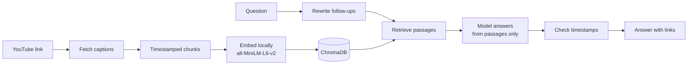

# YouTube Video Chatbot

Chat with any YouTube video. Paste a link, ask questions, and get answers grounded in what the video says, with timestamps that jump to the exact moment.

Built with Python, ChromaDB and Streamlit. Answers come from a free model on your own computer (through Ollama) or from Claude.

## How it works



1. **Fetch.** `youtube.py` reads the captions, preferring human-made English, then automatic English, then a translation, then the original language.
2. **Chunk.** `chunking.py` groups whole caption lines into overlapping chunks of about 60 words. Lines are never cut, so every word keeps its time.
3. **Store.** `vector_store.py` embeds the chunks on your CPU and saves them in ChromaDB, one collection per video. Reopening a video needs no re-indexing.
4. **Check the details.** Questions about the title, channel, length or link are answered straight from the video's details (`details.py`), since captions rarely mention them.
5. **Retrieve.** `retriever.py` picks a strategy for the question:
   - most questions use cosine similarity search
   - "Summarize this video" uses chunks from across the whole video
   - "What happens at 4:30?" also adds whatever is said at that time
   - follow-ups such as "why?" are first rewritten into standalone queries
6. **Answer.** `llm.py` (Claude) or `local_llm.py` (Ollama) streams an answer from a model told to use only the passages and cite a time for each claim.
7. **Verify.** `timestamps.py` checks each cited time against the passages the model was shown. Invented times are removed; real ones become links and play buttons.

## Run it

Needs Python 3.10 or newer.

```powershell
python -m venv .venv
.\.venv\Scripts\Activate.ps1
pip install -r requirements.txt
copy .env.example .env
streamlit run app.py
```

On macOS or Linux, use `source .venv/bin/activate` and `cp`.

The first video downloads the embedding model (about 80 MB). Then choose who writes the answers:

- **Free, on your computer.** Install [Ollama](https://ollama.com/download) and run `ollama pull qwen3.5:4b` (3.3 GB). The app finds it by itself, and nothing you ask leaves your computer. It fits on a 6 GB graphics card; other Ollama chat models work too.
- **Claude.** Put an [Anthropic API key](https://platform.claude.com/) in `.env`, or paste it in the sidebar. Better answers, billed per question.

With neither, the app quotes the best-matching sentences and says so when nothing in the video matches (`extractive.py`).

## Retrieval evaluation

```powershell
python -m evals.retrieval_eval
```

This measures whether search surfaces the moment that answers each of 20 hand-labelled questions about one 18-minute video. It needs no API key.

| Chunking (target/max/overlap words) | Chunks | Prompt words at k=8 | hit@1 | hit@3 | hit@6 | hit@8 | MRR |
|---|---|---|---|---|---|---|---|
| **50 / 75 / 15 (default)** | 62 | 508 | 45% | 75% | **100%** | **100%** | 0.64 |
| 50 / 75 / 0 | 55 | 489 | 45% | 80% | 95% | 100% | 0.65 |
| 110 / 150 / 30 | 34 | 980 | 55% | 90% | 90% | 95% | 0.71 |
| 250 / 300 / 60 | 16 | 2091 | 55% | 70% | 90% | 95% | 0.68 |

The model sees all retrieved chunks, so recall at k matters more than rank. Small chunks found every answer with about half the prompt text of medium ones, so they are the default even though larger chunks rank slightly better.

This is a small set: one question is worth 5 points, and the sizes were tuned on these same questions. It also covers retrieval only, not the quality of written answers.

## Tests

```powershell
pip install -r requirements-dev.txt
pytest
```

The tests run offline, with YouTube and the models replaced by fakes, and include the Streamlit interface.

## Settings

Set these in `.env`; see `.env.example`. Changes to chunk sizes affect newly added videos, so remove and re-add existing ones.

| Setting | Default | Meaning |
|---|---|---|
| `CLAUDE_MODEL` | `claude-opus-5-5` | Claude model used when there is a key (also selectable in the sidebar) |
| `CLAUDE_EFFORT` | `low` | How much Claude thinks; higher is slower |
| `LOCAL_MODEL` | `qwen3.5:4b` | Preferred local model when there is no API key |
| `TOP_K` | 8 | Passages retrieved per question |
| `CHUNK_TARGET_WORDS`, `CHUNK_MAX_WORDS`, `CHUNK_OVERLAP_WORDS` | 50, 75, 15 | Chunk sizes |
| `CHROMA_DIR` | `data/chroma` | Where embeddings are saved |

## Limitations

- Videos need captions, because the app reads the transcript rather than the audio or picture.
- The embedding model is trained on English, so search is weaker for videos that can't be translated.
- YouTube often blocks caption requests from cloud servers, so a hosted copy may need a proxy.
- Without a model, replies are quotes. They can miss the point of a question, and the "not found" cutoff was set on one video.
- Indexed videos are shared by everyone using the same running app.

## Layout

```
app.py                  Streamlit interface
video_chatbot/
  youtube.py            links, captions, titles
  chunking.py           captions to timestamped chunks
  vector_store.py       ChromaDB
  retriever.py          context selection
  details.py            title, channel and length questions
  extractive.py         quotes, for use without a model
  llm.py                prompts, and answers from Claude
  local_llm.py          answers from a local model
  timestamps.py         citation checking and links
  pipeline.py           joins the steps
  config.py, models.py  settings and data types
evals/                  retrieval evaluation
tests/
```
